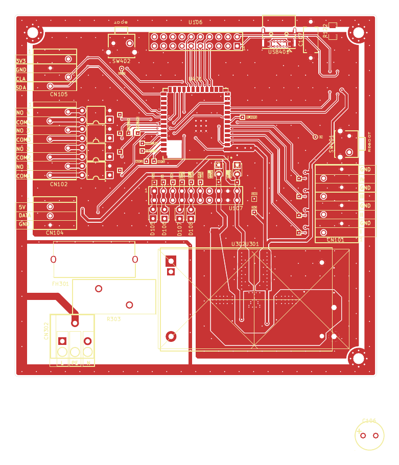
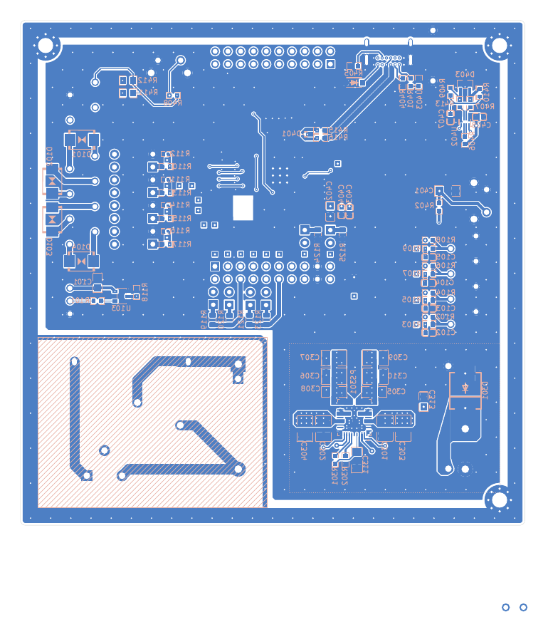
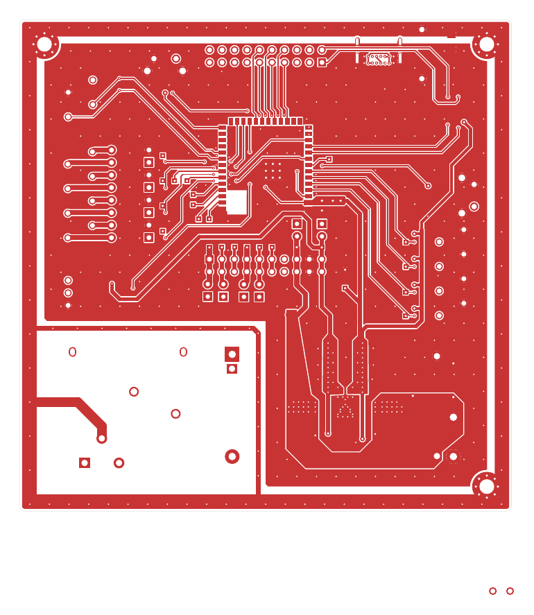
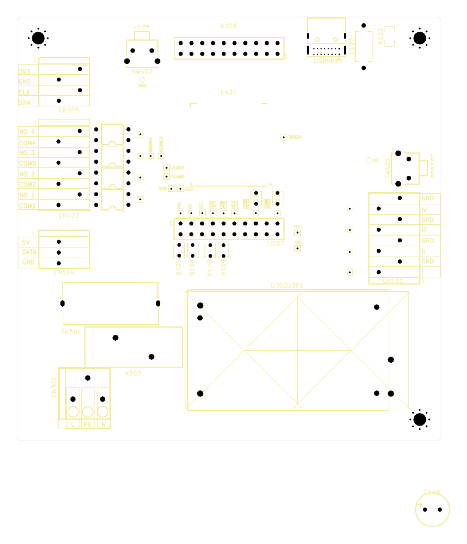
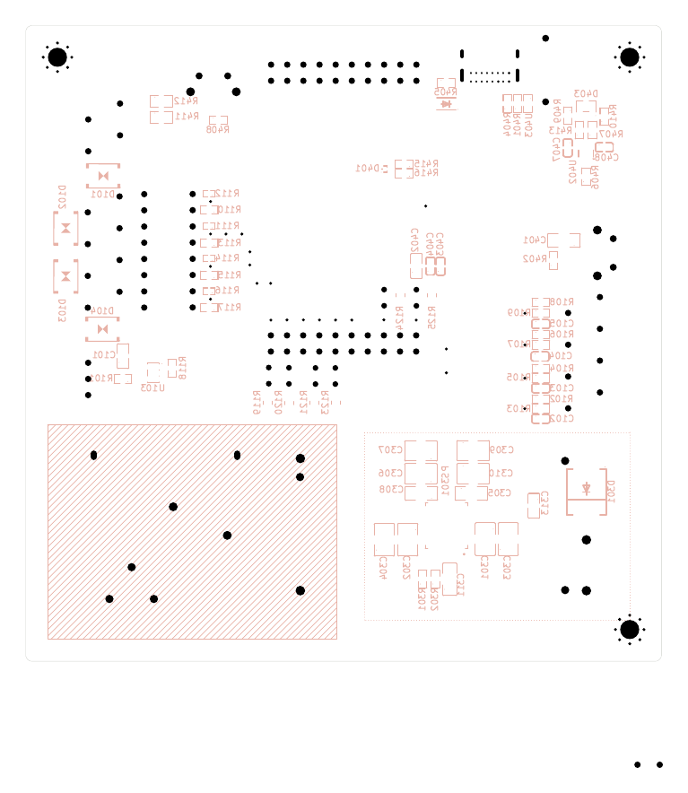

# IOT_LC

KiCad hardware project for the modular IoT controller.

## Project files

- `IOT_LC.kicad_pro` — KiCad project settings
- `IOT_LC.kicad_sch` — schematic
- `IOT_LC.kicad_pcb` — PCB layout
- `IOT_LC.kicad_dru` — custom design rules
- `IOT_LC.csv` — component list

**Status:** Work in progress; not validated for production.

**Safety:** The design includes mains voltage. It has not been certified or validated for safe mains operation. Do not assume it is safe to manufacture or energize.

<!-- AUTO-DOCS-START -->
## Schematic documentation

### Complete active hierarchical schematic

**Page 1**

[View vector PDF](docs/pdf/schematic.pdf)

## PCB documentation

### PCB front

**Page 1**

[View vector PDF](docs/pdf/pcb-front.pdf)

### PCB back

**Page 1**

[View vector PDF](docs/pdf/pcb-back.pdf)

### Individual PCB layers

**Page 1**

**Page 2**

**Page 3**

**Page 4**

[View vector PDF](docs/pdf/pcb-layers.pdf)
<!-- AUTO-DOCS-END -->
